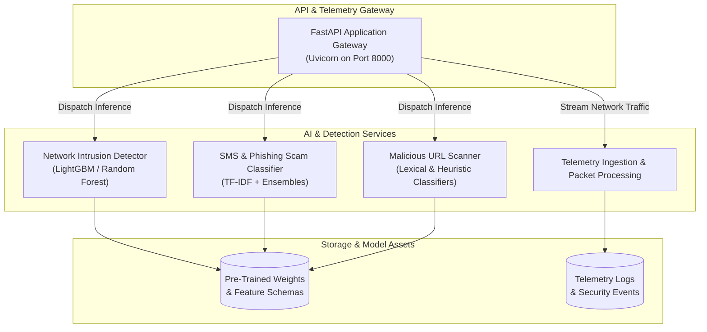
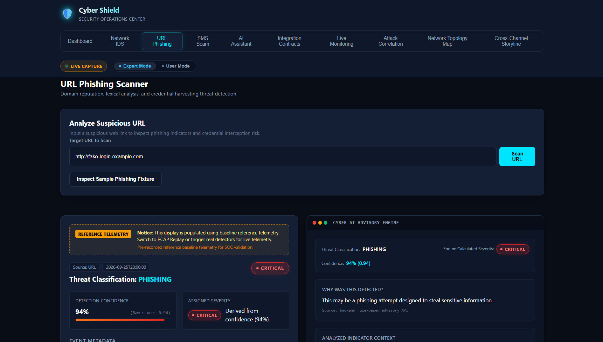
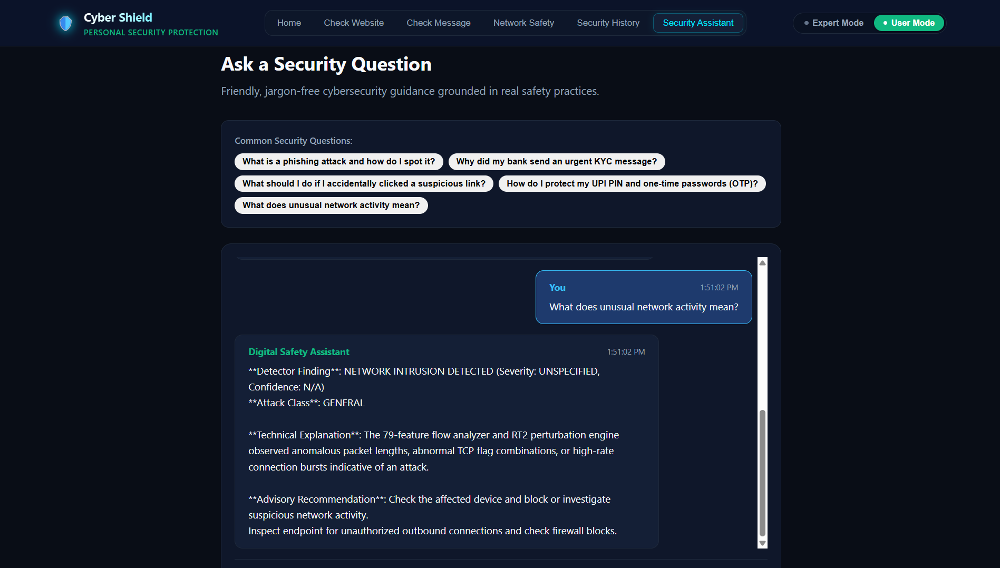

# CyberShield

<div align="center">

<p align="center">
  
  
  
  
  
</p>

</div>

---

## 1. Introduction

**CyberShield** is an integrated cybersecurity threat detection and monitoring platform designed for real-time security observability. The platform combines machine-learning-driven multi-vector intrusion detection, automated phishing and scam classification, live packet telemetry, and security intelligence endpoints to provide unified threat analysis and rapid incident response across enterprise environments.

---

## 2. System Architecture



---

## 3. Application Screenshots

<p align="center">
  
  
</p>
<p align="center">
  
  
</p>
<p align="center">
  
  
</p>
<p align="center">
  
  
</p>

---

## 4. Technology Stack

- **Core Backend:** Python 3.10+, FastAPI, Uvicorn, Pydantic v2
- **Machine Learning & Analytics:** Scikit-learn, LightGBM, NumPy, Pandas, Joblib
- **Security Telemetry:** Scapy, Network Packet Ingestion Pipeline, AsyncIO
- **Environment & Automation:** Windows / Linux support

---

## 5. Installation & Execution

### Prerequisites

- **Python:** Version 3.10 or 3.11 installed and accessible in system `PATH`
- **Operating System:** Windows 10/11 or modern Linux distribution

### Manual Backend Gateway Startup

```bash
# Navigate to the repository root
cd CyberShield_GitHub_Submission

# Create and activate a Python virtual environment
python -m venv .venv
# On Windows:
.venv\Scripts\activate
# On Linux/macOS:
# source .venv/bin/activate

# Install backend dependencies
pip install -r requirements.txt

# Start the FastAPI service
uvicorn backend_api.main:app --host 127.0.0.1 --port 8000 --reload
```

The FastAPI gateway exposes API documentation and health endpoints:
- **Interactive Swagger UI:** `http://127.0.0.1:8000/docs`
- **ReDoc Documentation:** `http://127.0.0.1:8000/redoc`
- **Service Health Check:** `http://127.0.0.1:8000/health`

---

## 6. Project Structure

```text
CyberShield/
├── backend_api/                 # FastAPI gateway, routes, and schemas
│   ├── main.py                  # API entry point & route registration
│   ├── routes/                  # Security endpoints (telemetry, threats, scan)
│   └── schemas/                 # Pydantic models & request/response schemas
├── configs/                     # System and detector configurations
├── data/                        # PCAP samples and deterministic test datasets
├── detectors/                   # AI & heuristic detection engines
│   ├── network/                 # Network intrusion detection engine
│   ├── sms/                     # SMS & text scam classifier
│   └── url/                     # Malicious URL analyzer
├── docs/                        # Project documentation & screenshots
│   └── screenshots/             # Interface gallery captures (01 to 08)
├── examples/                    # Evaluation and demonstration scripts
├── models/                      # Serialized ML models and preprocessors
├── tests/                       # Automated unit and integration tests
├── LICENSE                      # CyberShield Proprietary Software License
├── README.md                    # Primary project documentation
└── requirements.txt             # Backend Python dependencies
```

---

## 7. License & Attribution

Copyright © 2026 **LAKSHYA SREE T**, **SANJAY V S**, and **LAKSHITHA S**. All Rights Reserved.

This software is governed by the proprietary **CyberShield Proprietary Software License**. Ownership of custom detection engines, model architectures, and backend services is held by the Authors, while contributor-owned modules and third-party open-source components are recognized and governed under their respective terms.

For complete terms and conditions, refer to the [LICENSE](LICENSE) file located in the root of this repository.
