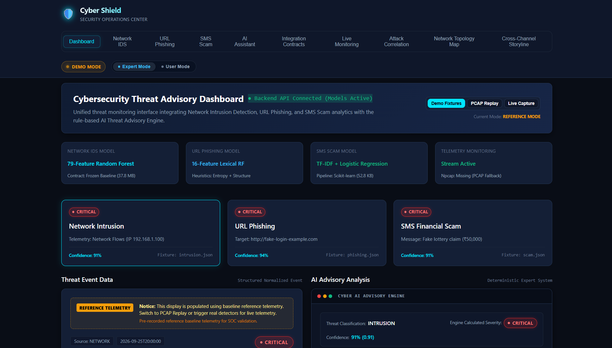
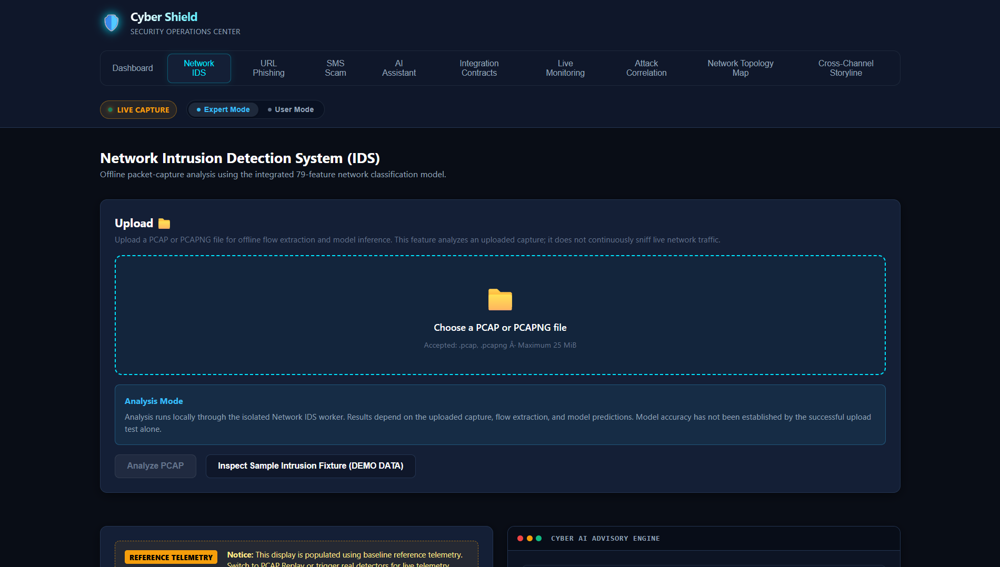
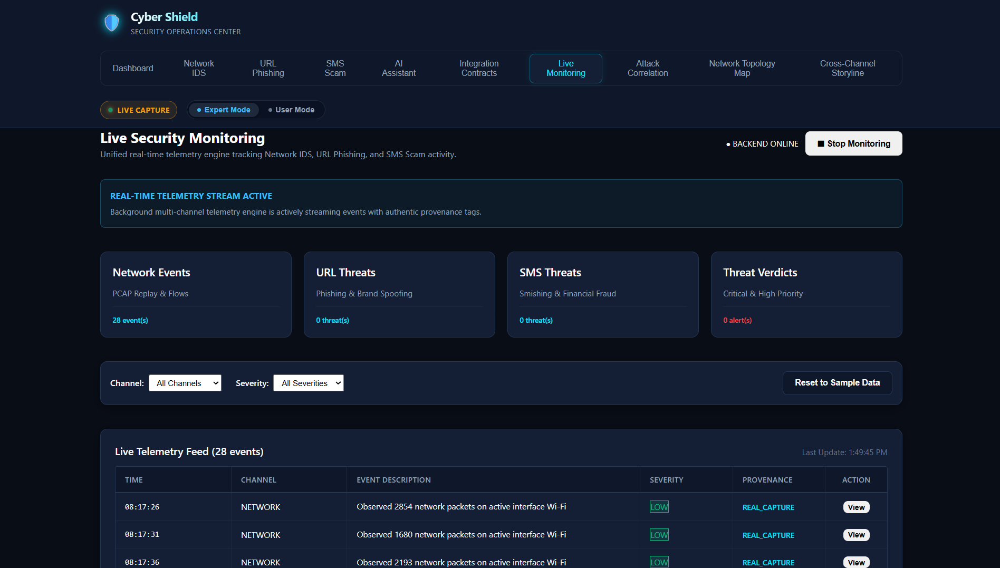
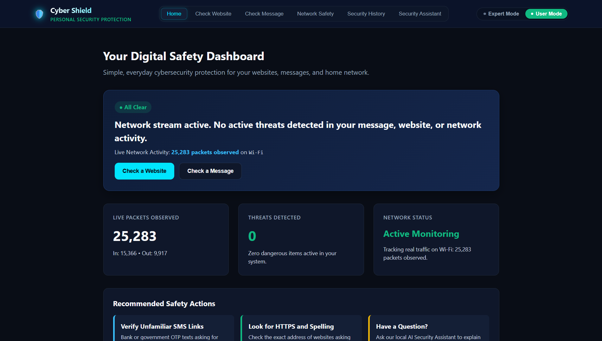
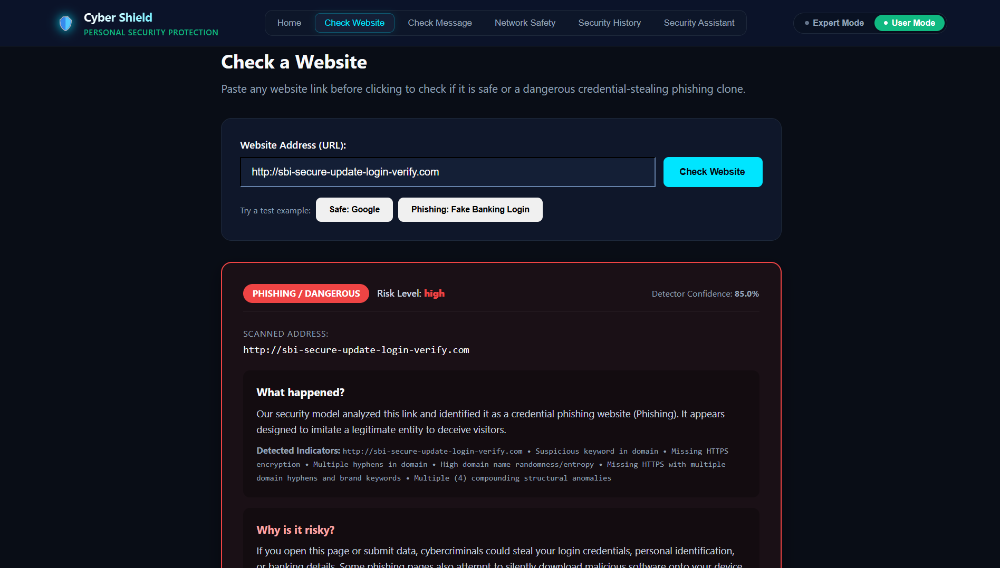
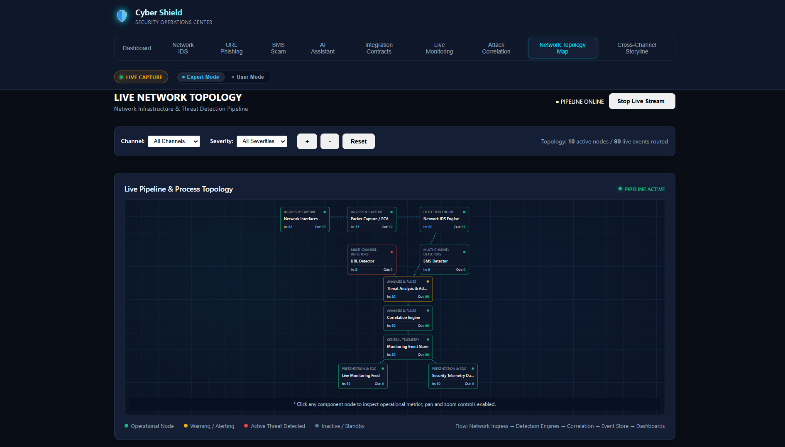
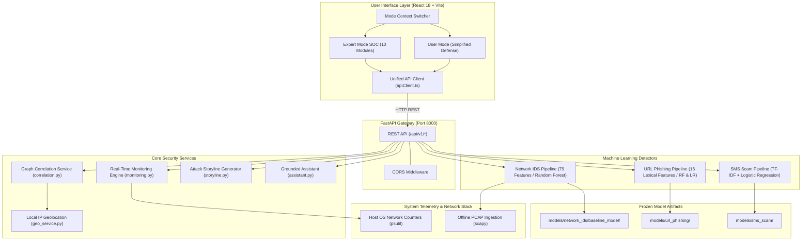

# CyberShield

<div align="center">


[](https://www.python.org/)
[](https://fastapi.tiangolo.com/)
[](https://react.dev/)
[](https://www.typescriptlang.org/)
[](https://vitejs.dev/)
[](https://scikit-learn.org/)
[](#system-requirements)
[](#current-development-status)

<p align="center">
  <strong>Comprehensive Full-Stack Cybersecurity Operations Center (SOC) & Multi-Channel Threat Intelligence Platform</strong>
</p>

<p align="center">
  <a href="#project-overview">Overview</a> •
  <a href="#application-gallery">Screenshots</a> •
  <a href="#system-architecture">Architecture</a> •
  <a href="#core-features">Features</a> •
  <a href="#technology-stack">Tech Stack</a> •
  <a href="#directory-structure">Structure</a> •
  <a href="#installation--setup">Setup</a> •
  <a href="#running-cybershield">Running</a> •
  <a href="#security-considerations">Security</a>
</p>

</div>

---

## Project Overview

**CyberShield** is an advanced, full-stack cybersecurity operations platform and unified intrusion defense system. Built for modern enterprise visibility and intuitive threat management, CyberShield correlates multi-vector security telemetry across three critical channels: **network packet streams**, **deceptive phishing URLs**, and **fraudulent SMS/message communications**.

### Problem Statement
Traditional security tools present fragmented views: network intrusion detection systems operate isolated from email/URL gateways, while messaging security rarely connects to endpoint packet forensics. When sophisticated threats execute cross-channel attacks—such as using an SMS smishing bait to direct users to a cloned credential harvesting site while initiating network reconnaissance—analysts face disjointed alert streams.

### Architectural Solution
CyberShield solves this by combining:
1. **Multi-Vector Machine Learning Classifiers**: Real-time evaluation of network flows (79 statistical features), URL structures (16 lexical & structural features), and SMS textual patterns (TF-IDF NLP).
2. **Deterministic Cross-Channel Incident Correlation**: Graph clustering that links shared Indicators of Compromise (IP addresses, domain names, hashes, phone numbers) into tamper-evident incidents.
3. **Dual-Mode Interactive Interface**:
   - **Expert Mode**: Advanced SOC workspace featuring 10 specialized forensic pages (packet inspection, telemetry mapping, incident storylines, rule-based mitigation).
   - **User Mode**: Streamlined cybersecurity interface for everyday users to inspect links, verify messages, review Wi-Fi security, and receive non-technical safety explanations.
4. **Air-Gapped & Privacy-Preserving Runtime**: Evaluates threats entirely on-device with zero reliance on cloud APIs, automatically suppressing PII and masking sensitive indicators.

---

## Current Development Status

CyberShield is actively developed and tested in native Windows and cross-platform environments. Below is the verified status of core components based on the current codebase:

| Component | Status | Implementation Details |
| :--- | :---: | :--- |
| **Network IDS (79 Features)** | **Operational** | Pre-trained Random Forest baseline (`models/network_ids/baseline_model/random_forest_baseline.joblib`) classifying 9 attack families (DoS, DDoS, PortScan, Patator, Bot, Web Attacks, Benign). |
| **URL Phishing Engine** | **Operational** | 16-feature lexical & structural Random Forest (`models/url_phishing/url_rf.joblib`) with ccTLD suppression and active confidence calibration. |
| **SMS Scam Engine** | **Operational** | TF-IDF Vectorizer + Logistic Regression (`models/sms_scam/sms.joblib`) with PII phone number redaction. |
| **Cross-Channel Correlation** | **Operational** | Graph clustering aggregating IOCs across network, URL, and SMS records with canonical cryptographic hashing. |
| **Dual-Mode Frontend** | **Operational** | Complete React 18 + TypeScript + Vite console with seamless, persistent switching between Expert Mode and User Mode. |
| **Live Network Observer** | **Operational** | Real-time traffic monitoring tracking packet counts (in/out) and flow volume across active network adapters (`Wi-Fi`, `Ethernet`). |
| **Grounded Security Assistant** | **Operational** | Deterministic, rule-grounded threat explanation engine generating actionable response playbooks without cloud API dependencies. |
| **Raw L2 Packet Sniffing** | **Conditional** | Promiscuous raw Layer-2 packet sniffing requires Windows Administrator privileges due to Npcap Admin-only mode; falls back to OS socket telemetry when unprivileged. |
| **Edge Llama ExecuTorch** | **Standby** | Quantized Llama-3.2-1B `.pte` model artifact prepared for ARM/aarch64 edge targets; host environment defaults to deterministic rule advisory to prevent hallucinations. |

---

## Application Gallery

The interface supports both advanced security analysts and non-technical end users. Below are actual screenshots of the running CyberShield application:

<table>
  <tr>
    <td width="50%" align="center">
      
      <br />
      <strong>01. Security Operations Center (SOC) Dashboard</strong>
      <p><em>Real-time threat status, detector health, multi-channel alert breakdown, and persistent Expert/User mode selector.</em></p>
    </td>
    <td width="50%" align="center">
      
      <br />
      <strong>02. Real-Time Telemetry Stream & Monitoring</strong>
      <p><em>Live incoming/outgoing packet counters, active network adapter tracking, and streaming event buffer.</em></p>
    </td>
  </tr>
  <tr>
    <td width="50%" align="center">
      
      <br />
      <strong>03. Network IDS & PCAP Flow Forensics</strong>
      <p><em>Offline PCAP/PCAPNG ingestion, 79 CICFlowMeter feature extraction, and attack classification.</em></p>
    </td>
    <td width="50%" align="center">
      
      <br />
      <strong>04. Security Telemetry & Topology Map</strong>
      <p><em>Network process topology, unlocated local telemetry partition, and private vs. public IP attribution.</em></p>
    </td>
  </tr>
  <tr>
    <td width="50%" align="center">
      
      <br />
      <strong>05. URL Phishing & Structural Risk Analyzer</strong>
      <p><em>Lexical entropy evaluation, brand spoofing detection, IP host alerts, and structured risk playbooks.</em></p>
    </td>
    <td width="50%" align="center">
      
      <br />
      <strong>06. Grounded Security Assistant</strong>
      <p><em>Air-gapped security explanations, incident investigation queries, and step-by-step mitigation advice.</em></p>
    </td>
  </tr>
  <tr>
    <td width="50%" align="center">
      
      <br />
      <strong>07. Cross-Channel Graph Correlation & Storyline</strong>
      <p><em>Multi-vector incident reconstruction linking SMS lures, phishing domains, and network probes.</em></p>
    </td>
    <td width="50%" align="center">
      
      <br />
      <strong>08. System Diagnostics & Pipeline Health</strong>
      <p><em>Subsystem health, verified detector contracts, offline model integrity, and Npcap capture readiness.</em></p>
    </td>
  </tr>
</table>

---

## System Architecture

CyberShield utilizes a clean, decoupled architecture connecting client applications to a consolidated FastAPI services gateway:



---

## Core Features

### 1. Dual-Mode Operations Interface
- **Expert Mode (Advanced SOC)**:
  - Complete visibility over 10 operational modules.
  - Interactive packet analysis, deep flow statistics, and raw model confidence displays.
  - Granular control over capture replay, live monitoring streams, and incident graphs.
- **User Mode (Consumer Safety)**:
  - Intuitive, jargon-free security portal for non-technical users.
  - Simple *"Check a Website"* and *"Check a Message"* submission forms with immediate green/amber/red risk cards.
  - Four structured explanation sections on every flagged threat:
    1. *What happened?*
    2. *Why is it risky?*
    3. *What should I do now?*
    4. *Prevention suggestions & best practices*.

### 2. Network Intrusion Detection (Network IDS)
- Implements the complete 79-feature flow extraction pipeline based on CICFlowMeter.
- Evaluates flows against a pre-trained **Random Forest Baseline** model (`random_forest_baseline.joblib`, 39.7 MB).
- Identifies 9 attack families: **BENIGN, Botnet, DDoS, DoS, Heartbleed, Infiltration, Patator (Brute Force), PortScan, and Web Attacks**.
- Supports pure offline parsing of `.pcap` and `.pcapng` capture files with flow duration, inter-arrival times, packet length distributions, and flag ratios.

### 3. URL Phishing Detection
- Extracts 16 lexical and structural attributes without accessing the live destination:
  - Lexical entropy, domain token lengths, and sub-domain counts.
  - Suspicious keywords (`login`, `secure`, `update`, `banking`, `verify`).
  - Literal IP address hostname detection.
  - Missing HTTPS encryption and compounding structural anomaly scoring.
- Incorporates ccTLD-aware false positive suppression.

### 4. SMS & Smishing Scam Detection
- Evaluates raw text messages using TF-IDF n-gram vectorization and Logistic Regression.
- Detects psychological manipulation patterns: artificial urgency, threats of account deactivation, lottery bait, and unauthorized banking links.
- Automatically redacts sensitive phone numbers and PII in compliance with privacy guidelines.

### 5. Real-Time Network Monitoring & Telemetry
- Observes real-time packet activity directly from active network adapters (`Wi-Fi`, `Ethernet`).
- Dynamically measures incoming vs. outgoing packet throughput, session byte counts, and monitor uptime.
- Distinguishes clearly between **Normal Encrypted Traffic**, **Suspicious Traffic**, and **Critical Intrusions** without inflating threat metrics.
- Surfaces exact hardware/OS capture states: *Active Monitoring*, *Standby*, *Permission Required*, or *Backend Disconnected*.

### 6. Cross-Channel Incident Correlation & Storylines
- Correlates multi-channel alerts into cohesive **Unified Incident Records**.
- Identifies composite multi-stage attacks where an initial SMS lure directs a target to a phishing portal while background network reconnaissance probes the perimeter.
- Assigns canonical SHA-256 digital seals to ensure tamper-evident forensic reporting.

### 7. Grounded Security Assistant
- Provides offline, evidence-backed security explanations.
- Answering questions regarding detected threats, protocol anomalies, and step-by-step remediation procedures.
- Strictly rule-grounded to prevent hallucinated advice or unverified technical claims.

---

## Technology Stack

### Backend
- **Language**: Python 3.10 – 3.13
- **Web Framework**: [FastAPI](https://fastapi.tiangolo.com/) 0.103+ with [Uvicorn](https://www.uvicorn.org/) ASGI server
- **Machine Learning**: [scikit-learn](https://scikit-learn.org/) 1.4+, [Joblib](https://joblib.readthedocs.io/), NumPy, Pandas
- **Packet Ingestion**: [Scapy](https://scapy.net/) 2.5+, CICFlowMeter flow extractor
- **System Telemetry**: [psutil](https://github.com/giampaolo/psutil) for OS-level interface & socket telemetry
- **Validation & Schemas**: [Pydantic](https://docs.pydantic.dev/) v2

### Frontend
- **Framework**: [React](https://react.dev/) 18.3.1
- **Language**: [TypeScript](https://www.typescriptlang.org/) 5.5.3
- **Build Tool**: [Vite](https://vitejs.dev/) 5.4.2
- **State Management**: React Context (`ModeContext` for persistent dual-mode switching)
- **Styling**: Modern CSS3 with CSS variables, responsive grid layouts, and custom dark theme

---

## Directory Structure

```
CyberShield/
├── backend_api/                     # Shared FastAPI application
│   ├── main.py                      # Master API entry point & route registration
│   ├── monitoring.py                # Live network monitoring & packet telemetry
│   ├── correlation.py               # Cross-channel event correlation engine
│   ├── storyline.py                 # Multi-stage incident storyline generator
│   ├── assistant.py                 # Grounded security assistant service
│   ├── geo_service.py               # IP geolocation resolution service
│   └── test_api.py                  # API test suite
├── configs/                         # Global system configurations
├── data/                            # Sample validation data & test PCAPs
│   ├── pcap_samples/                # Ingestion PCAP files
│   └── validation/                  # Malicious validation flows
├── detectors/                       # Modular detector inference code
│   ├── network/                     # Network IDS adapter, features & schemas
│   ├── url/                         # 16-feature URL phishing classifier
│   └── sms/                         # SMS scam NLP classifier
├── docs/                            # Documentation assets
│   └── screenshots/                 # Application gallery screenshots (01 to 08)
├── frontend/                        # React 18 + TypeScript frontend
│   ├── src/
│   │   ├── components/              # Reusable UI components (Navbar, ModeSwitcher)
│   │   ├── context/                 # Application Mode Context (Expert / User)
│   │   ├── modes/
│   │   │   └── user/                # User Mode pages (Dashboard, URL, SMS, Network)
│   │   ├── pages/                   # Expert Mode SOC pages (10 forensic views)
│   │   ├── services/                # Unified API client (apiClient.ts)
│   │   ├── types/                   # TypeScript interfaces and contracts
│   │   └── App.tsx                  # Root application router
│   ├── package.json                 # Frontend dependencies
│   └── vite.config.ts               # Vite configuration
├── models/                          # Pre-trained machine learning model artifacts
│   ├── network_ids/                 # 79-feature baseline Random Forest (39.7 MB)
│   │   └── baseline_model/          # Model, label encoder & features specification
│   ├── url_phishing/                # URL Random Forest and Logistic Regression
│   ├── sms_scam/                    # SMS TF-IDF and Logistic Regression
│   └── llama/                       # Edge model artifacts (.pte)
├── scripts/                         # Operational & packaging utilities
│   ├── create_final_submission_zip.py
│   └── verify_zip.py
├── threat_engine/                   # Advisory rules, recommendations, and severity
├── requirements.txt                 # Backend Python dependencies
├── start_application.bat            # One-click Windows startup script
├── setup_workspace.ps1              # PowerShell environment setup script
└── README.md                        # Project documentation
```

---

## Installation & Setup

### Prerequisites
- **Operating System**: Windows 10/11 (64-bit) or Linux (x86_64 / aarch64)
- **Python**: Version 3.10 to 3.13 installed and added to `PATH`
- **Node.js**: Version 18.x or newer with `npm` installed and added to `PATH`
- **Packet Capture Driver (Optional)**: [Npcap](https://npcap.com/) (for Windows raw packet sniffing; install with WinPcap compatibility mode)

### 1. Clone the Repository
```bash
git clone https://github.com/your-repo/CyberShield.git
cd CyberShield
```

### 2. Backend Setup
Set up a Python virtual environment and install the required packages:

```powershell
# Windows PowerShell
python -m venv venv
.\venv\Scripts\Activate.ps1
pip install -r requirements.txt
```

```bash
# Linux / macOS
python3 -m venv venv
source venv/bin/activate
pip install -r requirements.txt
```

### 3. Frontend Setup
Install frontend dependencies:

```bash
cd frontend
npm install
cd ..
```

---

## Running CyberShield

### Option A: One-Click Startup (Windows)
Double-click `start_application.bat` or execute it in PowerShell:

```powershell
.\start_application.bat
```
This script launches both the FastAPI backend (`http://127.0.0.1:8000`) and the Vite frontend (`http://localhost:5173`) in minimized background processes.

---

### Option B: Manual Startup

#### Terminal 1 — Start Backend Gateway
```powershell
# Activate virtual environment if configured
python -m uvicorn backend_api.main:app --host 127.0.0.1 --port 8000
```
Verify backend health by navigating to: `http://127.0.0.1:8000/api/v1/health`

#### Terminal 2 — Start Frontend Console
```powershell
cd frontend
npm run dev
```
Open your browser and navigate to: `http://localhost:5173`

---

## Testing & Verification

### Backend API Tests
Run the automated test suite using `pytest`:

```powershell
pytest backend_api/test_api.py -v
```

Test detector endpoints directly via Python or PowerShell:

```powershell
# Verify Backend Health
Invoke-RestMethod -Uri "http://127.0.0.1:8000/api/v1/health" -Method Get

# Test URL Phishing Detector
$body = @{ url = "http://secure-update-bank.com/login" } | ConvertTo-Json
Invoke-RestMethod -Uri "http://127.0.0.1:8000/api/v1/threats/scan-url" -Method Post -Body $body -ContentType "application/json"

# Test SMS Scam Detector
$smsBody = @{ message = "URGENT: Your account is suspended. Verify KYC now at http://bit.ly/kyc-fix" } | ConvertTo-Json
Invoke-RestMethod -Uri "http://127.0.0.1:8000/api/v1/threats/scan-sms" -Method Post -Body $smsBody -ContentType "application/json"
```

### Frontend Build Verification
Verify that TypeScript types and Vite production bundles compile cleanly:

```powershell
cd frontend
npm run build
```
*(Expected output: clean build with 0 TypeScript and bundling errors).*

---

## Security Considerations

1. **Air-Gapped Operation**: CyberShield does not communicate with external cloud APIs for threat classification. All Random Forest, Logistic Regression, and NLP models execute strictly on the local host.
2. **PII and Data Redaction**: Phone numbers, account numbers, and personal identifiers detected within SMS or URL payloads are masked prior to storage or display in the telemetry feed.
3. **Privilege Isolation**: The application does not require Administrator privileges to run. When non-admin users execute CyberShield, the monitoring engine uses OS-level network I/O counters rather than forcing unsafe root or admin access.
4. **Passive Analysis**: CyberShield never initiates offensive attacks, port scans, or external packet floods against third-party networks. All evaluation flows operate on replayed PCAPs, local loopback, or passive ingress monitoring.

---

## Development Roadmap

- [x] **Dual-Mode Architecture**: Full implementation of Expert SOC Mode (10 modules) and beginner-friendly User Mode with persistent switching.
- [x] **Real-Time Network Telemetry**: Integrated live network adapter packet observation (in/out counts, byte deltas, uptime).
- [x] **Multi-Channel Detectors**: Active integration of 79-feature Network IDS, 16-feature URL scanner, and TF-IDF SMS detector.
- [x] **Structured Risk Playbooks**: Clear, non-technical threat explanations and mitigation guides for all detected risks.
- [ ] **Automated Firewall Rule Synthesis**: Generate downloadable host firewall scripts (`nftables`, `iptables`, Windows Firewall) directly from high-confidence incident alerts.
- [ ] **Expanded Network Protocol Support**: Direct flow extraction for IPv6, QUIC, and DNS-over-HTTPS (DoH) sessions.
- [ ] **On-Device LLM Edge Deployment**: Complete hardware validation of the Llama-3.2-1B ExecuTorch `.pte` pipeline on physical Raspberry Pi 5 / ARM SBC hardware.

---

## Contributing

Contributions to improve CyberShield's detection accuracy, user experience, and documentation are welcome:

1. **Fork the Repository**
2. **Create a Feature Branch**: `git checkout -b feature/NetworkSensorEnhancement`
3. **Commit Your Changes**: Follow clear, descriptive commit messages. Ensure existing tests pass:
   ```bash
   pytest
   cd frontend && npm run build
   ```
4. **Push to Your Branch**: `git push origin feature/NetworkSensorEnhancement`
5. **Open a Pull Request**: Detail the changes made, tests performed, and any architectural implications.

---

## License

Licensing terms for CyberShield have not yet been formally specified. All pre-trained baseline model weights, application code, and interface assets are preserved for evaluation and research purposes.

---

## Acknowledgements

- **CIC-IDS Dataset Team** (Canadian Institute for Cybersecurity) for foundational network intrusion flow feature definitions.
- **Scikit-Learn & Joblib Maintainers** for robust machine learning model serialization and inference runtimes.
- **FastAPI & Uvicorn Community** for high-performance Python asynchronous REST services.
- **React & Vite Teams** for responsive, modern front-end tooling.
